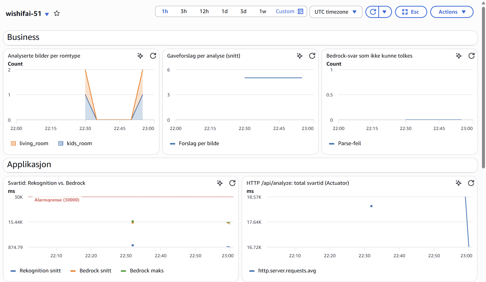
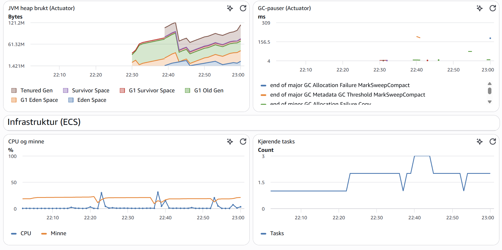

# PGR301 eksamen H26

Kandidatnummer: 51

Alle oppgavene er besvart.

## Begrunnelse for valg av region

Alt kjører i `eu-west-1`, fordi Rekognition ikke finnes i `eu-north-1`. Kommando `aws rekognition detect-labels --region eu-north-1` feilet, mens samme kall mot `eu-west-1` ga labels tilbake. Applikasjonen bruker samme region for alle AWS-klientene (S3, Rekognition, Bedrock og CloudWatch).

## Oppgave 1A – Containerisér Spring Boot-applikasjonen

`Dockerfile` har to steg. Det første bygger JAR-filen med `maven:3.9-eclipse-temurin-21`. `pom.xml` kopieres inn og laster ned dependencies før kildekoden kopieres, så Docker kan gjenbruke det laget helt til det kommer nye endringer i dependencies. Det andre steget bygger på `eclipse-temurin:21-jre-alpine` og inneholder bare JRE og JAR-filen. Maven, JDK og kildekode blir igjen i byggesteget. Det ferdige imaget er rundt 112 MB komprimert, og prosessen kjører som en egen bruker (`app`) i stedet for root.

Bygg imaget fra repo-roten og start det:

```bash
docker build -t wishifai-51 .
```

```bash
docker run --rm -p 9999:8080 \
  -e AWS_ACCESS_KEY_ID -e AWS_SECRET_ACCESS_KEY -e AWS_SESSION_TOKEN \
  -e S3_BUCKET=wishifai-51-images \
  wishifai-51
```

Pipelinen i 1B publiserer også imaget til Docker Hub. Da kan man hoppe over build og kun bruke:

```bash
docker run --rm -p 9999:8080 \
  -e AWS_ACCESS_KEY_ID -e AWS_SECRET_ACCESS_KEY -e AWS_SESSION_TOKEN \
  -e S3_BUCKET=wishifai-51-images \
  smaddicted/wishifai-51:latest
```

Applikasjonen lytter på 8080 inne i containeren, og `-p 9999:8080` gjør den tilgjengelig på `localhost:9999`. Når `-e` skrives uten verdi hentes variabelen videre fra terminalen kommandoen kjøres i, så nøklene ikke må stå i selve kommandoen, men deklareres i forkant med `aws configure`.

Test fra repo-rot:

```bash
curl -F "image=@samples/sample_image.png" http://localhost:9999/api/analyze
```

## Oppgave 1B – CI-pipeline

Workflowen ligger i `.github/workflows/ci.yml` og kjøres ved push til `main`. Imaget bygges én gang og pushes til ECR (`wishifai-51` i `eu-west-1`), som ECS henter fra i oppgave 2. AWS-nøklene og Docker Hub-token ligger som GitHub Secrets. ECR-repoet opprettet jeg manuelt med CLI, med skanning ved push slått på.

Samme image pushes også til Docker Hub (`smaddicted/wishifai-51`). Vi fikk beskjed om at dette ikke var nødvendig likevel, men jeg hadde allerede satt det opp og har beholdt det, grunnet at jeg ønsker å ha imaget liggende på min egen konto, utenfor klassens AWS-konto, for personlig historisk dokumentasjon.

Grønn kjøring: https://github.com/smaddicted/pgr301-eksamen-2026/actions/runs/41232385098/job/124629083523

### Tagging-strategi

Hvert image får to tagger: den korte commit-SHA-en (sju tegn) og `latest`. SHA-taggen er den som betyr noe. Den peker på en spesifikk commit, så man alltid kan se hvilken kode som kjører, og kan rulle tilbake ved å deploye en eldre tag. `latest` flytter seg ved hvert bygg og sier ingenting sikkert om innholdet. Den er med fordi det er praktisk å kunne skrive `docker pull ...:latest` lokalt.

## Oppgave 2 – ECS Express med Terraform

### 2A – Infrastruktur for tjenesten

Terraform-koden ligger i `infra/` og oppretter ECS Express-tjenesten, en S3-bucket for bildene, en task role og en log group for containerloggene. Region, kandidatnummer og image-tag er variabler. Image-taggen settes av pipelinen i 2C. Execution role og Infrastructure role refereres direkte til med ARN fra oppgaveteksten.

`S3_BUCKET` settes i `application.properties` og hentes rett fra bucket `aws_s3_bucket.images.bucket`. Bucket navnet er da definert i en single source of truth, og tjenesten kan ikke ende opp med å peke på en annen bucket enn den Terraform har laget. `AWS_REGION` settes også, så applikasjonen garantert bruker samme region som bucket.

Helsesjekken peker på `/actuator/health`, og CPU og minne er satt til 0,5 vCPU og 1 GiB. AWS oppgir 0,25 vCPU og 512 MiB som standard, og det gir en heap på rundt 128 MB. Dashboardet fra oppgave 3 viser at applikasjonen bruker opp mot 120 MB heap, så verdiene er økt for å ha litt å gå på.

Task rollen heter `wishifai-51-task-role` og har kun de tilgangene som trengs av koden:

- `s3:PutObject` under `uploads/` i egen bucket
- `rekognition:DetectLabels`
- `bedrock:InvokeModel` på inference profilen og modellen den ruter til
- `cloudwatch:PutMetricData`, begrenset til namespacet `wishifai-51`

`DetectLabels` og `PutMetricData` støtter ikke tilgangsstyring på ressursnivå, og står derfor med `*` som ressurs. Bucketen blokkerer all offentlig tilgang.

Outputs er blant annet URL-en til tjenesten, bucketnavn, task role-ARN, image-URI og lenke til dashboardet.

Offentlig URL: https://wi-30133c46bca2473f95c16b71c471a466.ecs.eu-west-1.on.aws

Testspørring:

```bash
curl -F "image=@samples/sample_image.png" https://wi-30133c46bca2473f95c16b71c471a466.ecs.eu-west-1.on.aws/api/analyze
```

Svaret tar 15–20 sekunder. Mer om det i oppgave 3.

### 2B – Remote state

State ligger i den bucket `pgr301-terraform-state` under filnavnet `wishifai/51/terraform.tfstate`.

`use_lockfile = true` er tatt med for å forhindre at pipeline og utvikler ikke kan skrive til staten samtidig. Backend-blokken kan ikke bruke variabler, så bucket, nøkkel og region står skrevet rett inn i `providers.tf`.

### 2C – Terraform i pipelinen

`ci.yml` inneholder to jobber; `build-and-push` og `terraform`. `terraform` har `needs: build-and-push` og kjører `terraform fmt -check`, `init`, `validate` og `apply` mot `infra/`. Byggejobben gir fra seg image-taggen som output, og Terraform-jobben får den inn som `TF_VAR_image_tag`. Nøklene kommer fra secrets i GitHub Actions. `fmt -check` kjører før alt annet, så feilformatert kode stopper pipelinen før noe blir endret.

Grønn kjøring med begge jobbene: https://github.com/smaddicted/pgr301-eksamen-2026/actions/runs/41247725477

### Hvorfor Terraform kjører etter container-bygget

Tjenesten peker på en bestemt image-tag i ECR. Hvis Terraform kjørte først eller parallelt, kunne `apply` satt en tag som ikke er pushet ennå, og ECS ville prøvd å starte et image som ikke finnes. Med `needs:` kjører `apply` bare når build og push har gått bra, og det som deployes er imaget som nettopp ble bygget fra samme commit. Feiler build, stopper pipelinen før infrastrukturen blir rørt.

Terraform-jobben inneholder også en `concurrency`-gruppe, så to pusher rett etter hverandre ikke kjører `apply` samtidig.

## Oppgave 3 – Observability

### 3A – Metrikker i applikasjonen

Applikasjonen hadde feilmeldinger før denne oppgaven, fordi `namespace()` i `MetricsConfig` returnerte en tom streng, og CloudWatch avviste hver publisering med «The parameter Namespace is required». Nå leses namespacet fra `app.metrics.namespace` i `application.properties`.

De to AWS-kallene har hver sin `Timer`: `wishifai.rekognition.duration` rundt `DetectLabels` og `wishifai.bedrock.duration` rundt `Converse`. Disse to deler svartiden i det som brukes av bildeanalysen og det som brukes av språkmodellen. Tiden måles med `Timer.record()` og ikke `@Timed`, fordi annotasjon krever AOP som ikke er på classpath. `record()` måler uansett også tiden selv om kallet kaster en exception.

Det er to business-metrikker:

- `wishifai.images.analyzed` er en `Counter` med taggen `room`, altså antall analyserte bilder per romtype (`living_room`, `kids_room`, `garage`, `kitchen`, `other`). Romtypen utledes fra Rekognition-labelene. Den forteller hvem som faktisk bruker tjenesten. Kommer nesten alle bildene fra barnerom, er det der prompten og markedsføringen bør spisses.
- `wishifai.suggestions.per.analysis` er en `DistributionSummary` over hvor mange gaveforslag brukeren får per bilde. Prompten ber om inntil fem. Faller snittet mot ett, får brukerne lite igjen for å laste opp et bilde, og det kan være tegn på et problem med prompt eller språkmodellen.

Den siste metrikken, `wishifai.bedrock.parse.failures`, teller hvor ofte Bedrock svarer med noe som ikke er gyldig JSON. Prompten ber om JSON, men modellen følger ikke alltid det. Da klarer ikke applikasjonen å lese svaret, og brukeren får HTTP 200 med et tomt standardsvar i stedet for gaveforslag. Sett utenfra ser alt ut til å virke, så uten en egen teller ville jeg ikke oppdaget det.

Spring Boot registrerer mange flere metrikker enn applikasjonen trenger, og CloudWatch tar betalt per metrikk. Derfor er det lagt inn et `MeterFilter` som bare slipper gjennom det applikasjonen bruker.

### 3B – Dashboard og alarm

Dashboard og alarmer er definert i `infra/monitoring.tf`. Dashboardet heter `wishifai-51` og ligger i `eu-west-1`. Det har tre rader:

- Business: analyserte bilder per romtype, snitt antall gaveforslag per analyse og antall Bedrock-svar som ikke kunne tolkes.
- Applikasjon: svartid for Rekognition og Bedrock i samme graf med alarmgrensen tegnet inn, total svartid for `/api/analyze`, brukt JVM-heap og GC-pauser. De tre siste kommer fra Actuator.
- Infrastruktur: CPU- og minnebruk og antall kjørende tasks for ECS-tjenesten, fra namespacet `AWS/ECS`.

Hver rad fokuserer på hvert sitt område. Business-raden viser om brukerne får det de kom for, hvem som bruker tjenesten, og om de får gaveforslag tilbake. Applikasjonsraden viser hvor tiden går. De to timerne skiller Rekognition og Bedrock, og HTTP-grafen viser hvor lenge brukeren venter totalt. Heap og GC er med for å kunne utelukke at tregheten skyldes JVM-en. Infrastruktur-raden viser om containeren har nok CPU og minne, og om ECS holder den i live.




### Alarmer

Begge alarmene er knyttet til mine egne metrikker og sender varsel til SNS-emnet `wishifai-51-alarms`, som er koblet til epost. Adressen settes som variabel i GitHub og står ikke i koden.

`wishifai-51-bedrock-latency` varsler når gjennomsnittet av svartiden mot Bedrock er over 30 sekunder i tre av fem minutter. Gunderen var bekymret for treghet, og Bedrock står for nesten hele svartiden, så det er riktig sted å måle. Grensen er omtrent det dobbelte av normal svartid. Lavere enn det ville gitt varsler hver gang modellen skriver et litt lengre svar. Kravet om tre av fem datapunkter gjør at ett enkelt tregt kall ikke sender epost.

`wishifai-51-bedrock-parse-failures` varsler hvis et Bedrock-svar ikke kan tolkes som JSON. Den fanger en feil ingen andre metrikker ser, fordi kallet er raskt nok og gir HTTP 200, men brukeren får ikke gaveforslag.

Begge alarmene regner manglende data som «ikke brudd». Uten trafikk kommer det ingen målinger, som ikke er en feil.

## Oppgave 4 – Drøfteoppgave

Applikasjonen har nå et dashboard som viser at tjenesten er oppe, og to alarmer som sier fra hvis den blir treg eller svarer med noe som ikke kan leses. Dette fanger derimot ikke opp om modellen foreslår en kniv til en tiåring. Det kommer raskt nok, er gyldig JSON og gir HTTP 200. Det er en viktig forskjell AI gjør for DevOps, at ting som er feil kan se helt riktige ut.

Overvåkingen må derfor også se på innholdet i svarene. Noe kan måles automatisk, som hvor ofte modellen nekter å svare, eller om svarene plutselig blir kortere eller dyrere enn før. Romtype-metrikken i dashboardet viser om bildene brukerne laster opp endrer seg over tid, men et menneske blir nødt til å dømme om et forslag er passene, for eksempel gjennom stikkprøver eller en knapp der brukeren kan melde fra. I en gaveapp som Wishifai er det en grei løsning, men i en bank ville dette vært å oppdage for sent.

Da må mer av jobben gjøres før produksjon, men problemet at svaret er forskjellig hver gang. Man kan ikke skrive en test som sjekker at et bilde av en stue gir et bestemt forslag. Man kan derimot teste egenskaper ved svaret, som at det er gyldig JSON, har har maks fem forslag, eller at et barnerom ikke gir forslag med smådeler. Et fast sett med bilder kan kjøres i pipelinen, gjerne med en annen modell som dommer, og resultatet telles som andel godkjente svar over mange kjøringer. For Wishifai kan en slik test nøye seg med å varsle. Der en feil vil koste penger eller helse, må den stoppe deployen, og et menneske på inn i loopen.

Alt dette forutsetter at endringen faktisk går gjennom pipelinen. SHA-taggen min forteller hvilken kode som kjører, men modellen velges med miljøvariabelen `BEDROCK_MODEL_ID` og kan byttes uten at en kodelinje endres. Prompten ligger heldigvis i koden og er versjonert sammen med resten. Et modellbytte eller en ny prompt bør behandles som en deploy: samme testsett, mulighet for å rulle tilbake, og helst utrulling til en liten andel av trafikken først. I en bank burde det i tillegg kreves at en fagperson godkjenner endringen, og logger prompt, modellversjon og svar, så det går an å forklare i ettertid hvorfor et råd ble gitt.

For Wishifai er det greit å rette opp i etterkant. Et dårlig gaveforslag er ikke optimalt, men ingen tar skade av det. Jo mer en feil koster, desto tidligere må den fanges, og i rådgivning som kan påføre noen et tap, bør et menneske lese rådet før kunden får det.
